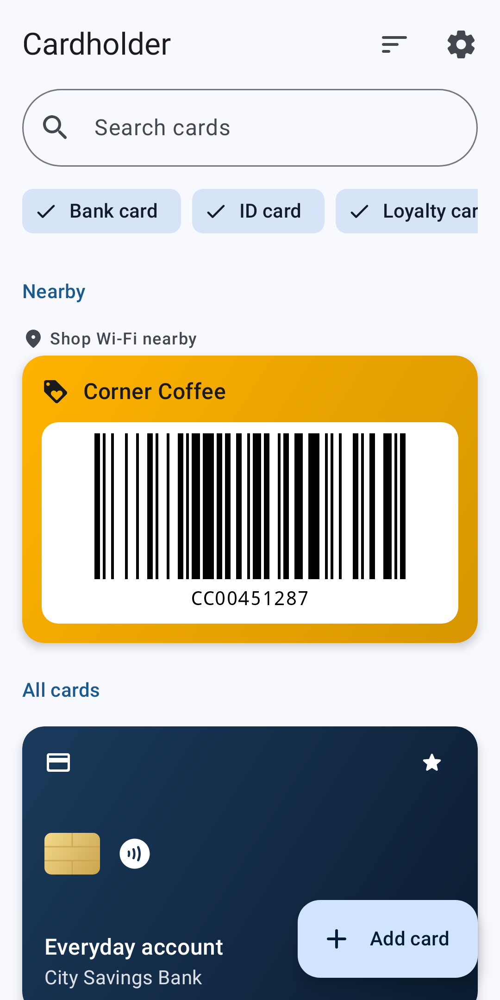
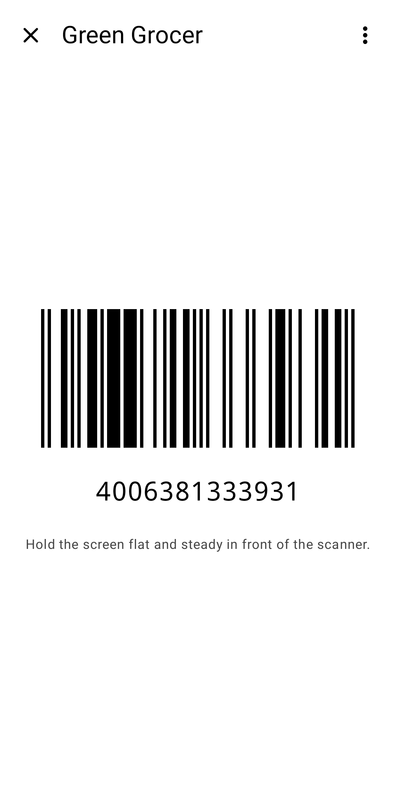
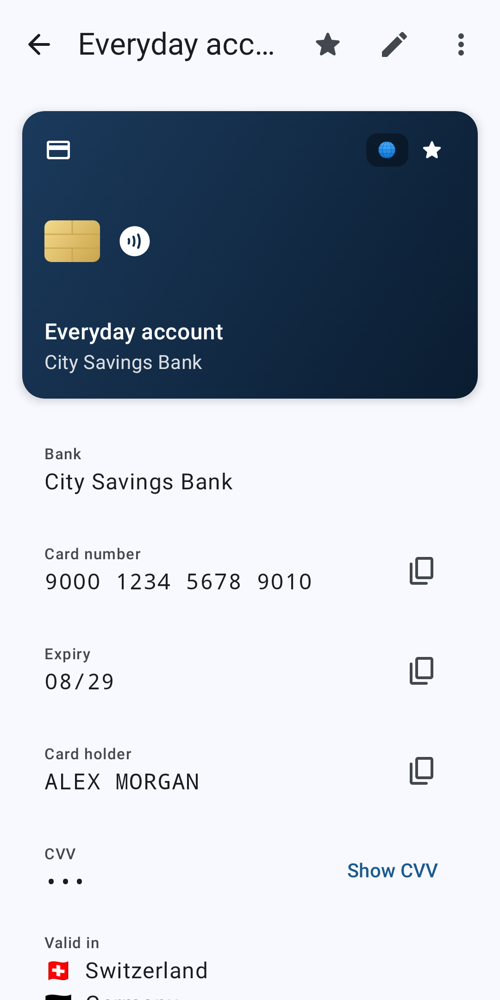
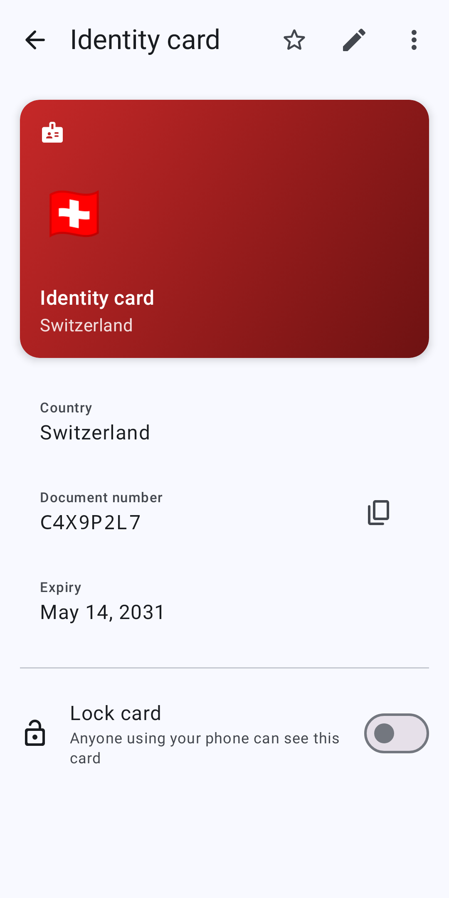
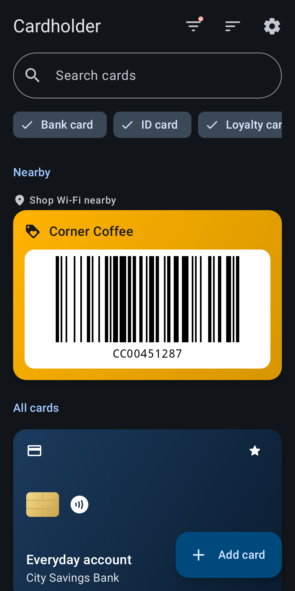

# Cardholder

[](https://github.com/danyk20/cardholder/actions/workflows/ci.yml)
[](https://github.com/danyk20/cardholder/releases/latest)
[](LICENSE)


An offline, privacy-first Android wallet for your **bank cards**, **ID cards** and **loyalty cards**.

<!-- The Play Store screenshots, rendered from the app's UI by the StoreScreenshotTest tests (./gradlew recordRoborazziDebug). -->
<p>
  
  
  
  
  
</p>

## Features
- **Three card types**
  - **Bank card**: issuing bank (catalogue of 145 banks in Europe, Switzerland and the US, or any name), number (network detection, Luhn check), expiry, card holder and CVV. **Tap the card on the phone (NFC)** to fill in number, expiry and, if the card provides it, the holder. The CVV is **always hidden** and only shown after fingerprint, face or device PIN.
  - **ID card**: issuing country (searchable, with flags), optional document number and expiry.
  - **Loyalty card**: shop from a catalogue of 55 shops or a custom name, plus its barcode/QR code, which is shown **right on the card in the list**. Tapping the card shows the code **full-screen at maximum brightness** for the till scanner. 13 symbologies are supported, including EAN, UPC, Code 128/39/93, ITF, Codabar, QR, Aztec, Data Matrix and PDF417.
  - **Shop and bank logos**: pick the official logo (freely licensed, downloaded on request), upload your own, or keep the card plain. Bank cards also show the card network logo (Visa, Mastercard, Amex, Maestro, Discover, JCB, UnionPay, Diners) automatically.
- **Optional photos of both sides**: scan with automatic edge detection (ML Kit document scanner) or pick from the gallery.
- **Scan loyalty codes** with the camera, or let the app find the barcode in a card photo.
- **Per-card lock**: any card can require authentication for *all* its data.
- **Card suggestions by location** (opt-in): the app learns where you show each card (location and Wi‑Fi networks, on the device only) and puts the cards used nearby at the top of the list, or notifies you when you arrive at the shop. Battery-friendly: no background service; arrival notifications use the system's geofences.
- **Places on a map**: each card's learned places are shown on a map and in a list. Move a wrong place to the right spot, delete one, or add a place by tapping the map. Map tiles come from OpenStreetMap.
- **Where a card is valid**: a card can be valid in all countries or only in chosen ones (with EU, Schengen, Eurozone and EEA shortcuts). The card list and the widget show the cards valid in the country you are in, found on the device from the mobile network (or, if already allowed, your approximate location with offline borders). The filter can be switched off, and the country picked by hand.
- **Password-encrypted backup** export/import.
- **Updates from within the app**: *Check for updates* in Settings, optionally weekly. The Google Play version updates through Google Play; the GitHub version downloads the new release from GitHub and installs it after Android's confirmation.
- Material 3 with dynamic colour, dark theme, adaptive layout.

## Privacy & security
- **Offline by design.** No analytics, no cloud, no accounts. The app only goes online when you ask it to: to download an official shop logo from Wikimedia Commons, or to check for updates (from Google Play or GitHub, depending on where you installed it; optionally once a week). HTTPS only; no card data is ever sent. Places learned for card suggestions stay in the encrypted database and are never exported.
- Encrypted database (SQLCipher) **plus** per-value envelope encryption with Android Keystore keys.
- CVVs and locked cards are encrypted with a key the Keystore only releases after **strong biometric or device-credential authentication**. This is real cryptographic protection, not just a UI gate.
- Screenshots and recents thumbnails are blocked on sensitive screens (screenshots can be allowed temporarily in Settings, until you leave the app). Copied values are marked sensitive and cleared after a minute. Decrypted data is dropped when the app goes to the background.

Details: [SECURITY.md](SECURITY.md) and the [architecture decision records](docs/adr).

## Tech stack
Kotlin 2.4 · Jetpack Compose · Material 3 · Hilt · Room + SQLCipher · Android Keystore · CameraX · ML Kit · ZXing · Coil · Glance · WorkManager · Play services location · Coroutines/Flow · kotlinx.serialization · Gradle convention plugins · Spotless/ktlint · detekt · Kover · Robolectric/Roborazzi · GitHub Actions

## Building
Requirements: JDK 17+, Android SDK with platform 37.
The app comes in two flavors: `github` (the APK on GitHub releases, updates itself from GitHub) and `play`
(the bundle for Google Play, updated by Play).
```bash
./gradlew assembleGithubDebug                # build the debug app (GitHub flavor)
./gradlew testDebugUnitTest                  # unit & Robolectric tests
./gradlew spotlessCheck detekt lintDebug     # static analysis
./gradlew connectedDebugAndroidTest          # instrumented tests (device/emulator)
./gradlew koverHtmlReport                    # coverage report
```
Releases are built by GitHub Actions; see [docs/RELEASING.md](docs/RELEASING.md) and the [changelog](CHANGELOG.md).

## Architecture
Multi-module clean architecture with unidirectional data flow. See [docs/ARCHITECTURE.md](docs/ARCHITECTURE.md).
```
app/                 Application, navigation, DI wiring, Coil image loader
build-logic/         Gradle convention plugins
core/model           Pure Kotlin domain models
core/domain          Repository contracts, use cases, validators
core/data            Repository implementations, shop catalogue, backup
core/database        Room + SQLCipher
core/location        Location & Wi-Fi signals, geofences for card suggestions
core/map             The only module that uses MapCompose: places on OpenStreetMap tiles, with the tile cache
core/security        Keystore keys, envelope encryption, clipboard, session lock
core/storage         Encrypted card photo storage
core/scanning        Document & barcode scanning (ML Kit, CameraX)
core/barcode         Barcode/QR rendering (ZXing)
core/designsystem    Theme, card surface, icons, card network logos
core/ui              Shared UI: card face, authenticator, secure screens
core/testing         Test fakes and fixtures
feature/*            Card list, editor, detail, full-screen barcode, settings
```

## Contributing & security
See [CONTRIBUTING.md](CONTRIBUTING.md) and [SECURITY.md](SECURITY.md). Never put real card data in issues.

## Credits
- Map tiles © [OpenStreetMap](https://www.openstreetmap.org/copyright) contributors, [ODbL](https://opendatacommons.org/licenses/odbl/).
- Map drawing by [MapCompose](https://github.com/p-lr/MapCompose), Apache License 2.0.

## License
[Apache License 2.0](LICENSE). Shop names and logos are trademarks of their respective owners and are used only to identify the shop a card belongs to. The repository contains no logo files, only links to freely licensed logos on Wikimedia Commons; see [docs/LOGOS.md](docs/LOGOS.md) for sources and licences.

Country borders in `core/location/src/main/assets` are derived from [Natural Earth](https://www.naturalearthdata.com/) admin-0 countries (public domain). See `tools/country-borders/README.md`.
